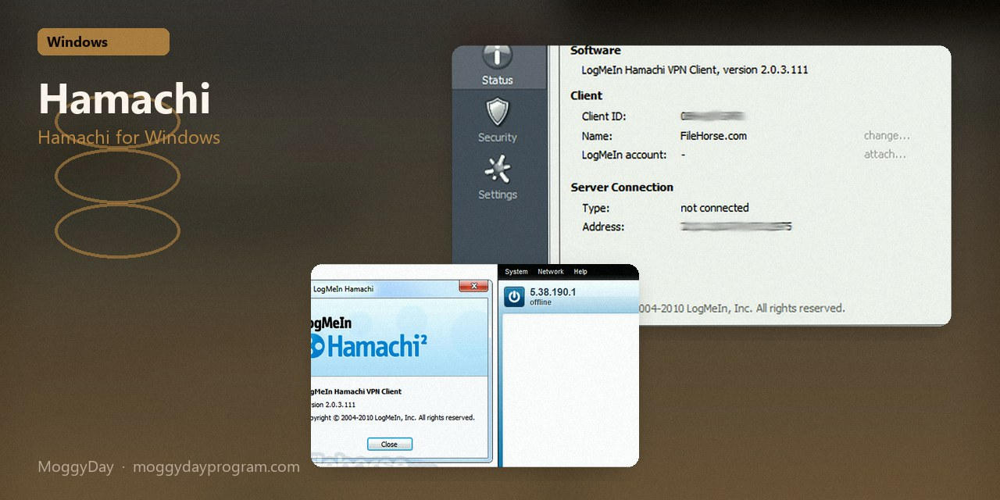
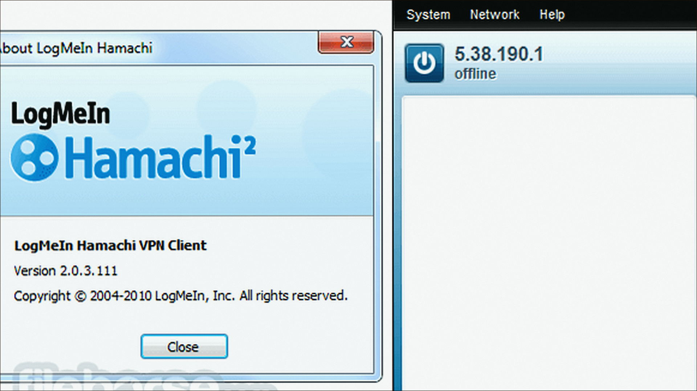
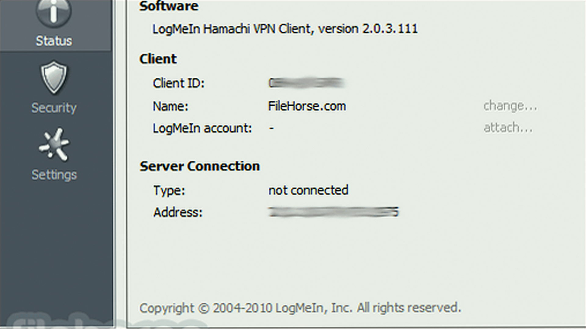
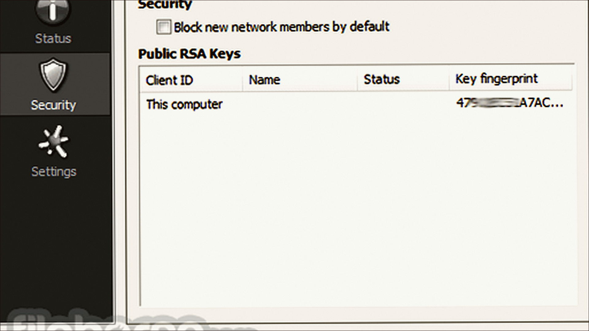

# Hamachi 2.2.0

Hamachi on Windows 10/11 x64. 12 MB. Requirements, screenshots, MoggyDay Launcher.

Site: [EN](https://moggydayprogram.com/en/programs/hamachi) · [RU](https://moggydayprogram.com/programs/hamachi) · [Pages](https://laserbetweenmap.github.io/hamachi-windows/)

  

  
  
  

## Hamachi for Windows

- Size: 12 MB
- Updated: 15 Oct 2026
- Windows 10/11 x64

## Links

- https://moggydayprogram.com/en/programs/hamachi
- https://moggydayprogram.com/programs/hamachi
- https://moggydayprogram.com/categories/utilities

Also: 
- [Cloudflare WARP](https://moggydayprogram.com/programs/cloudflare-warp)
- [NetLimiter](https://moggydayprogram.com/programs/netlimiter)
- [AnyDesk](https://moggydayprogram.com/programs/anydesk)

Pages: https://laserbetweenmap.github.io/hamachi-windows/
